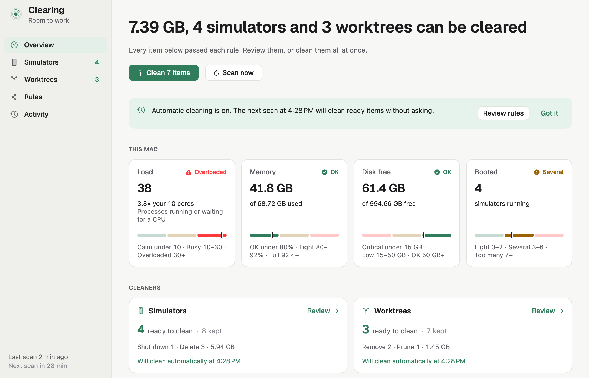
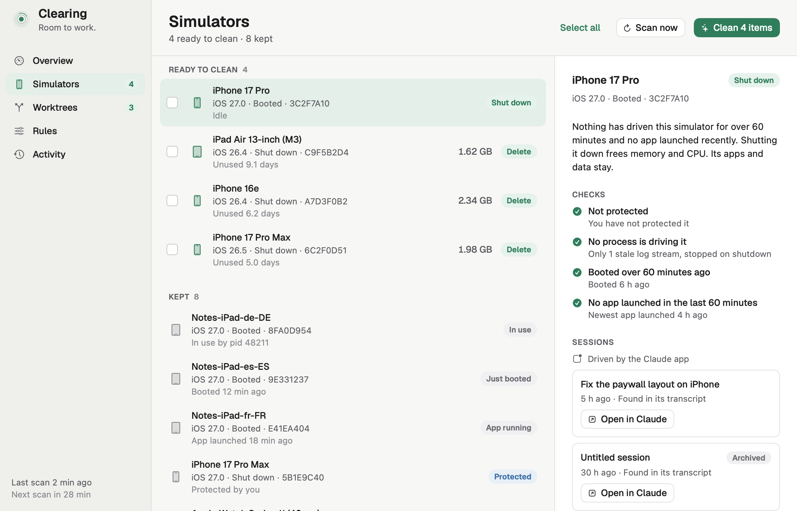
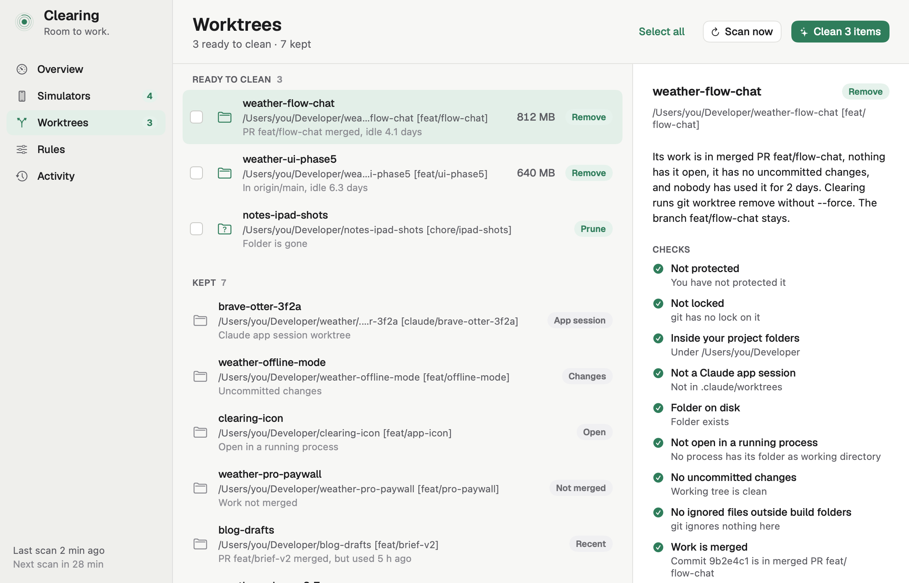
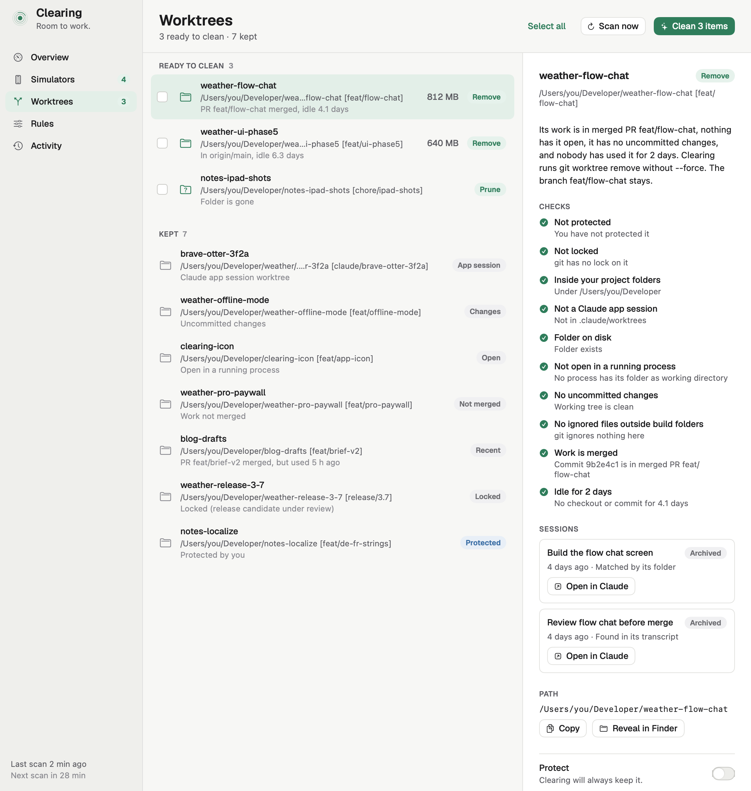
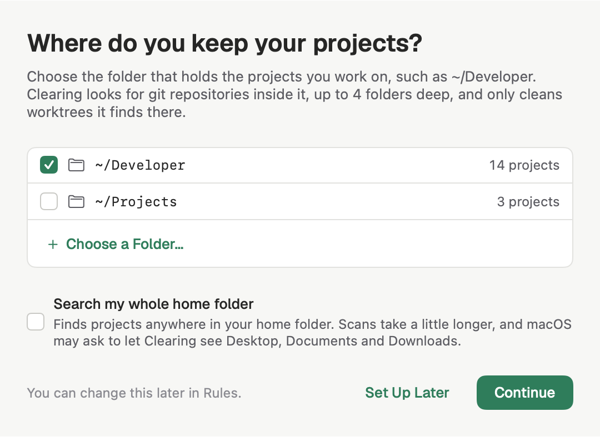
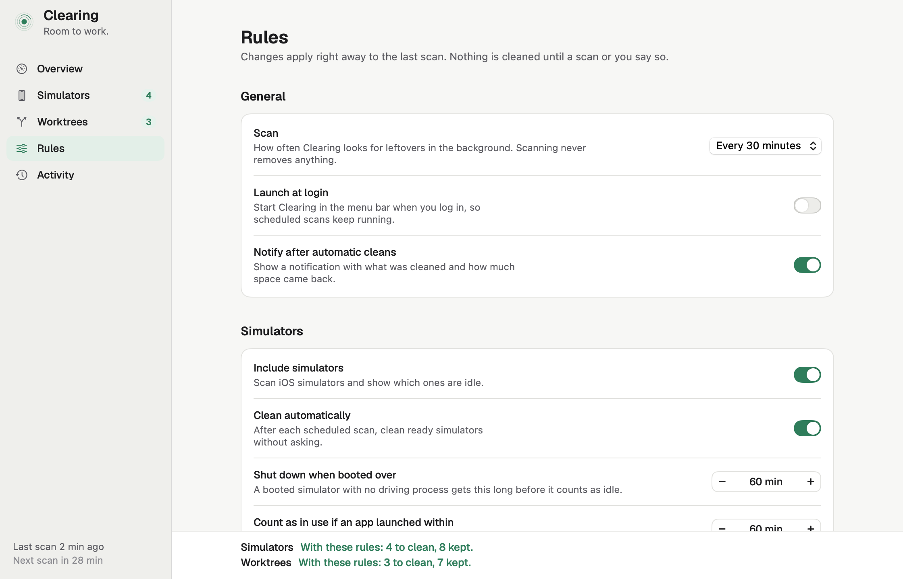
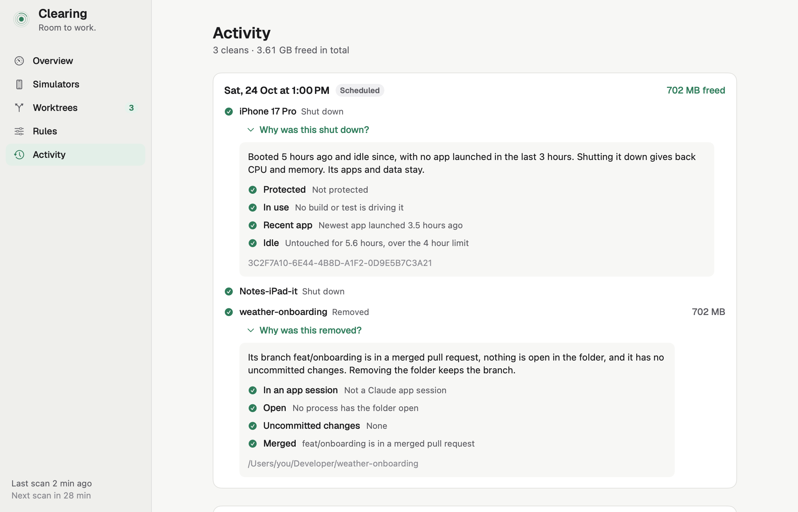
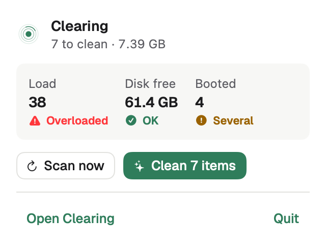

# Clearing

**Room to work.** Clearing is a Mac app that clears away what Xcode and AI coding agents leave behind: iOS simulators that keep running after a build finishes, and git worktrees nobody returns to. It shows each one, explains why it is safe to remove or why it is kept, and cleans on a schedule you set.

<picture>
  <source media="(prefers-color-scheme: dark)" srcset="screenshots/overview-dark.png">
  
</picture>

## Why it exists

Coding sessions boot simulators and create worktrees, then move on. Left alone, booted simulators push the load average far past the number of cores, and stale worktrees and simulator data fill the disk. Clearing finds them, checks that nothing still uses them, and removes them.

## What it cleans

### Simulators

- **Shuts down** a booted simulator that has been up for over an hour with no build, test or app using it. Its apps and data stay.
- **Deletes** a shut-down simulator unused for 3 hours, and keeps the last device of each name.
- **Keeps** anything still driven by `xcodebuild` or `simctl`, recently booted, or protected by you.

<picture>
  <source media="(prefers-color-scheme: dark)" srcset="screenshots/simulators-dark.png">
  
</picture>

### Worktrees

- **Removes** a worktree folder only when its work is merged (in the default branch or a merged pull request), nothing has it open, it has no uncommitted changes, and it has been idle for 2 days.
- **Prunes** git's entry for a worktree whose folder is already gone.
- **Keeps** locked worktrees, Claude app session worktrees, anything with uncommitted changes or unmerged work, and anything outside your project folders.

It runs `git worktree remove` without `--force`, and your branches always stay.

<picture>
  <source media="(prefers-color-scheme: dark)" srcset="screenshots/worktrees-dark.png">
  
</picture>

### See which session used it

The detail pane lists the Claude sessions that used a simulator or worktree, including archived ones, with a button that opens the session in the Claude app.

<picture>
  <source media="(prefers-color-scheme: dark)" srcset="screenshots/sessions-worktree-archived-dark.png">
  
</picture>

## Install

1. Download the latest `Clearing-x.y.z.zip` from [Releases](https://github.com/bingcheng45/clearing-mac-releases/releases/latest).
2. Unzip it and drag **Clearing** into **Applications**.
3. Open it. The app is signed and notarized by Apple, so it opens without a warning.

You need:

- macOS 15 or later.
- Xcode or the Xcode command line tools, for simulators (`xcrun simctl`) and `git`.
- Optional: the [GitHub CLI](https://cli.github.com) (`gh`), signed in. Clearing uses it to see whether a worktree's branch is in a merged pull request. Without it, only work already in the default branch counts as merged, so more worktrees are kept.

Installed copies update themselves. You can also choose **Check for Updates…** in the app menu.

## Set it up

Clearing scans as soon as it opens. That first scan never cleans anything, so you can look before anything changes.

<picture>
  <source media="(prefers-color-scheme: dark)" srcset="screenshots/setup-dark.png">
  
</picture>

1. **Choose where your projects are.** The first time Clearing opens, it asks where you keep your projects. Pick the parent folder that holds them, such as `~/Developer`. Clearing suggests folders on your Mac that already hold projects, and you can choose more than one. Clearing finds repositories inside these folders, up to 4 folders deep, and only cleans worktrees it finds there. To search everywhere, tick **Search my whole home folder**. macOS may then ask to let Clearing see Desktop, Documents and Downloads. You can skip this step and come back to it from the Worktrees screen, or change the folders later in **Rules**.
2. **Review the rules.** Each rule says what it does in one line, and the bar at the bottom shows how many items each cleaner would clean with your settings. Change the idle times, the scan interval, or turn automatic cleaning off for either kind.
3. **Protect what you want to keep.** Select any simulator or worktree and turn on **Protect**. Clearing will always keep it.
4. **Clean.** Press **Clean** to review the list, then confirm. Or leave automatic cleaning on, and each scheduled scan cleans what is ready.
5. **Optional: launch at login.** Turn it on in Rules so scheduled scans keep running from the menu bar.

<picture>
  <source media="(prefers-color-scheme: dark)" srcset="screenshots/rules-dark.png">
  
</picture>

Automatic cleaning is on by default for both kinds. Turn it off in Rules if you would rather press Clean yourself.

## Check what happened

**Activity** lists every clean, what it freed, and any error. Expand an item to see why it was removed and the checks it passed.

<picture>
  <source media="(prefers-color-scheme: dark)" srcset="screenshots/activity-why-dark.png">
  
</picture>

The menu bar shows the load, free disk and booted simulators, with Scan now and Clean.

<picture>
  <source media="(prefers-color-scheme: dark)" srcset="screenshots/menubar-dark.png">
  
</picture>

## Let an agent use it (optional)

Clearing includes an MCP server, so Claude Code and other agents can scan, explain a verdict, protect an item or run a clean through the same rules and checks as the app. To add it to Claude Code, run:

```sh
claude mcp add --scope user clearing -- /Applications/Clearing.app/Contents/MacOS/Clearing --mcp
```

## Trial and license

Clearing is free for 7 days with every feature. After that, a license key unlocks it. You can buy one and enter your key from the app.

## About this repository

This repository holds only signed releases and the update feed (`appcast.xml`). The source code is private. The screenshots use sample data.
